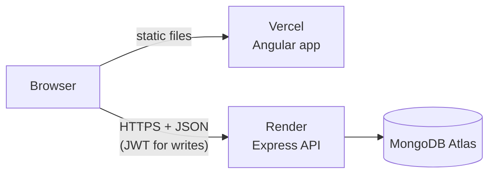

# M&J Quality Used Cars

A full-stack used-car dealership site: a public inventory and blog, plus a staff area for managing both.

**Live demo:** https://mjqualitycars.vercel.app

> **Portfolio project.** This was originally built for a used-car dealer and is now maintained as a portfolio piece. The business name is used for realism, but the phone number, email, address and opening hours are placeholders, the contact form is a demo that sends nothing, and the site is marked `noindex`.
>
> The API runs on a free hosting tier, so the first request after a quiet period can take up to a minute while the server wakes up.

## Features

**Visitors**
- Browse the inventory and filter by vehicle type (sedan, pickup, coupe, SUV, micro, motorcycle)
- Vehicle detail pages with a photo gallery, zoomable lightbox, specs and equipment list
- Blog with categories and article pages
- Contact page with a demo form
- Responsive layout, keyboard-friendly focus styles and `prefers-reduced-motion` support

**Staff (login required)**
- Add, edit and delete vehicles
- Write and edit blog posts in a rich-text editor (Quill)
- Sessions use signed JWTs that expire after 8 hours

## Tech stack

| Layer | Technology |
| --- | --- |
| Frontend | Angular 21 (standalone components, signals), TypeScript, hand-written CSS with design tokens |
| Rich text | Quill via `ngx-quill` |
| Backend | Node.js, Express 4 |
| Database | MongoDB with Mongoose |
| Auth | `jsonwebtoken` (JWT), `bcrypt` password hashing |
| Hosting | Vercel (frontend), Render (API), MongoDB Atlas (database) |

## How it fits together



The frontend is a static single-page app. It calls the API directly from the browser, so the API only accepts requests from an allow-list of origins (see [CORS](#cors)).

## Project structure

```
.
├── backend/
│   ├── server.js          # Express app: models, auth middleware, all routes
│   ├── package.json
│   └── .env.example       # Environment variables the API needs
└── frontend/
    ├── src/app/           # Angular components (home, products, blog, contact, admin login)
    └── src/styles.css     # Design tokens and shared animations
```

## Getting started

### Prerequisites
- Node.js 20.19 or newer (required by Angular 21)
- A MongoDB database (a free [MongoDB Atlas](https://www.mongodb.com/atlas) cluster works)

### 1. Run the API

```bash
cd backend
npm install
cp .env.example .env
```

Open `.env` and fill in the values. The file is git-ignored, so real credentials stay on your machine:

```bash
MONGODB_URI=mongodb+srv://<username>:<password>@<cluster-host>/<database-name>?retryWrites=true&w=majority
JWT_SECRET=<a-long-random-string>
PORT=3000
```

| Variable | Purpose |
| --- | --- |
| `MONGODB_URI` | Your MongoDB connection string (the example above is a placeholder, so use your own values) |
| `JWT_SECRET` | A long random string used to sign login tokens. The server refuses to start without it. |
| `PORT` | Port to listen on (defaults to `3000`) |

Generate a suitable secret with:

```bash
node -e "console.log(require('crypto').randomBytes(48).toString('hex'))"
```

Then start the server:

```bash
npm start
```

### 2. Run the frontend

```bash
cd frontend
npm install
npm start
```

The app opens at http://localhost:4200.

By default it talks to the deployed API. To use your local API instead, change the URL in `frontend/src/app/api-config.ts`:

```ts
export const API_BASE = 'http://localhost:3000';
```

### 3. Create a staff account

There is no sign-up page, on purpose. Create the first admin directly in the database.

Generate a password hash (run from the `backend` folder):

```bash
node -e "console.log(require('bcrypt').hashSync('choose-a-strong-password', 10))"
```

Then insert a document into the `admins` collection (for example with MongoDB Compass or `mongosh`):

```json
{ "username": "admin", "password": "<the hash from the previous step>" }
```

Sign in at `/adminlogin`. A "Staff login" link is also in the site footer.

## API reference

Reading is public. Anything that changes data needs an `Authorization: Bearer <token>` header, where the token comes from `POST /api/login`.

| Method | Endpoint | Auth | Description |
| --- | --- | --- | --- |
| `POST` | `/api/login` | No | Exchange a username and password for a token |
| `GET` | `/api/cars` | No | List vehicles |
| `GET` | `/api/cars/:id` | No | One vehicle |
| `POST` | `/api/cars` | Yes | Create a vehicle |
| `PATCH` | `/api/cars/:id` | Yes | Update a vehicle |
| `DELETE` | `/api/cars/:id` | Yes | Delete a vehicle |
| `GET` | `/api/blogs` | No | List blog posts |
| `GET` | `/api/blogs/:id` | No | One post by id |
| `GET` | `/api/blogs/slug/:slug` | No | One post by slug |
| `POST` | `/api/blogs` | Yes | Create a post |
| `PATCH` | `/api/blogs/:id` | Yes | Update a post |
| `DELETE` | `/api/blogs/:id` | Yes | Delete a post |
| `POST` | `/api/blogs/migrate-slugs` | Yes | One-off helper that fills in missing slugs |

## Deployment

**Frontend (Vercel).** Import the repository and set:

| Setting | Value |
| --- | --- |
| Root Directory | `frontend` |
| Build Command | `npm run build` |
| Output Directory | `dist/mj-quality-cars/browser` |

**API (Render).** Create a Node web service from the `backend` folder with start command `npm start`, and set the `MONGODB_URI` and `JWT_SECRET` environment variables. Never commit real values for these.

### CORS

The API only answers browsers visiting an approved origin. The list is `allowedOrigins` in `backend/server.js`. If you deploy the frontend somewhere new, add its URL there, or API calls from the browser will fail.

## Known limitations

- **Images are stored in the database as base64 text.** This keeps the project simple but makes the list endpoints large (several megabytes). Moving images to file storage such as Cloudinary and saving only URLs is the obvious next step.
- **The login token is kept in `localStorage`**, which is simple but exposed to any script on the page. An `httpOnly` cookie would be stronger.
- **Free-tier cold starts** make the first API call slow after idle periods.

## Credits

Vehicle photos and copy are sample content for demonstration purposes.
